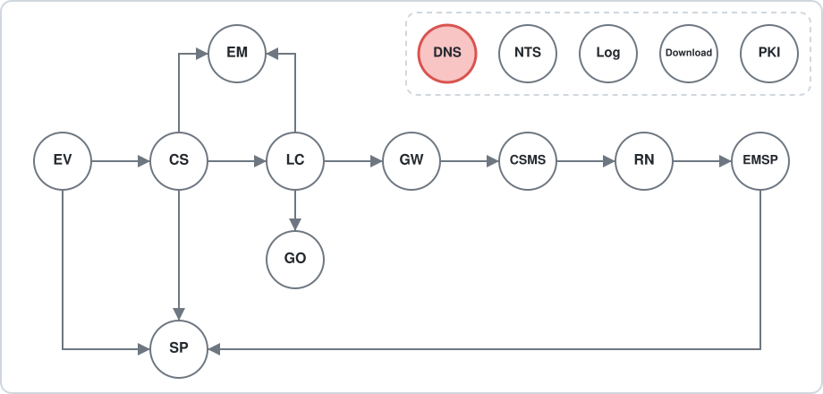

# DNSServer

One name server for a local network, as a WWCP node: Hermod's DNS server,
answering over UDP and TCP with the records of the `dnsServer` section of the
node's configuration file - and a web interface, a JSON API below
`/api/v1/dnsServer`, and a command line at the console and over SSH that list,
add and remove them (`dnsServer`, `records`, and `aRecords`,
`aaaaRecords`, `txtRecords` and `cnameRecords` for A, AAAA, TXT and CNAME
records).

It is not built alone: [DNSServerCLI](https://github.com/OpenChargingCloud/DNSServerCLI)
carries it as a submodule beside the libraries it needs, and runs its tests.
